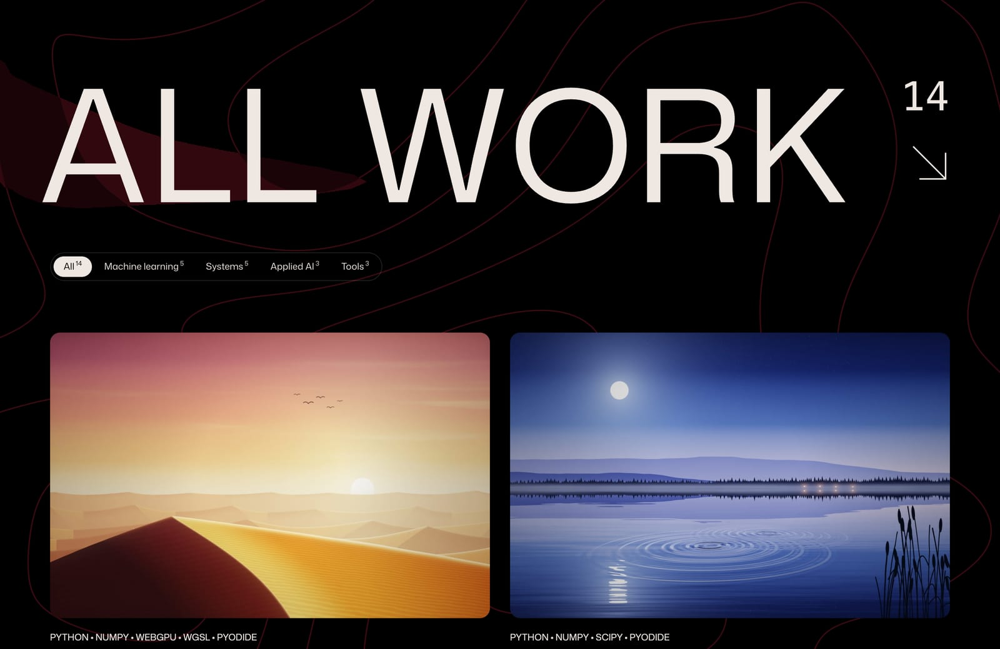

# dhanushkrishna4.github.io

The portfolio site of Dhanush Krishna, a machine learning and systems engineer: fourteen projects, each with its own page, over one WebGL canvas that runs behind every page. A static Astro site, deployed to GitHub Pages.

[](astro.config.mjs)
[](src/scripts/gl/engine.js)
[](https://dhanushkrishna4.github.io/)

[Live site](https://dhanushkrishna4.github.io/) · [Projects](#projects-on-the-site) · [How it works](#how-it-works) · [Run locally](#run-locally) · [Deploying](#deploying)

<p>
  
  
</p>

## Highlights

- **One canvas behind every page:** contour lines that the pointer stirs as it moves, a 3D monogram on the home page, red lines that draw themselves as you scroll, and the project cards' pictures, all drawn with three.js on a single WebGL canvas.
- **Pictures drawn in code:** each project card shows a scene drawn by a script, with a depth map behind it, so hovering pulls the focus from near to far and moving the pointer shifts the near parts against the far ones.
- **Page changes without reloads:** each page is fetched and swapped in place, so the canvas, header and menu stay put; pages change behind a curtain, and opening a project zooms into its card.
- **Scrolling in step with the canvas:** smooth wheel scrolling on desktop, and on touch screens the page is moved by script, a drag and then a glide, so nothing drawn on the canvas falls behind the page.
- **Project pages:** a write-up beside a gallery that scrolls sideways on wide screens and runs as a column on phones; at the end, keep scrolling to open the next project.
- **About:** a red line through the heading, and giant words behind the list of interests that light up under the pointer and slide as you scroll.
- **Contact:** a short form that opens your own mail app with the message written out, so nothing is sent through a third party.
- **Holds up without the extras:** with reduced motion the browser does the scrolling and transitions are cut short; without WebGL, plain versions show instead: the pictures as images, a flat monogram and outlined words.

## Projects on the site

| Project | Area | What it is | Links |
| --- | --- | --- | --- |
| [Forge](https://dhanushkrishna4.github.io/work/forge/) | Machine learning, Systems | Deep-learning framework and WebGPU compiler | [Code](https://github.com/DhanushKrishna4/Forge) · [Demo](https://dhanushkrishna4.github.io/Forge/) |
| [Meridian](https://dhanushkrishna4.github.io/work/meridian/) | Machine learning | Causal inference lab | [Code](https://github.com/DhanushKrishna4/Meridian) · [Demo](https://dhanushkrishna4.github.io/Meridian/) |
| [Mycelium](https://dhanushkrishna4.github.io/work/mycelium/) | Machine learning | Neural cellular automata that grow and repair | [Code](https://github.com/DhanushKrishna4/Mycelium) · [Demo](https://dhanushkrishna4.github.io/Mycelium/) |
| [Posterior](https://dhanushkrishna4.github.io/work/posterior/) | Machine learning | Bayesian inference engine | [Code](https://github.com/DhanushKrishna4/Posterior) · [Demo](https://dhanushkrishna4.github.io/Posterior/) |
| [Loom](https://dhanushkrishna4.github.io/work/loom/) | Systems, Machine learning | LLM inference engine in Rust and WebAssembly | [Code](https://github.com/DhanushKrishna4/Loom) · [Demo](https://dhanushkrishna4.github.io/Loom/) |
| [Escapement](https://dhanushkrishna4.github.io/work/escapement/) | Systems | Raft consensus under deterministic simulation | [Code](https://github.com/DhanushKrishna4/Escapement) · [Demo](https://dhanushkrishna4.github.io/Escapement/) |
| [Orrery](https://dhanushkrishna4.github.io/work/orrery/) | Systems | SQL query engine in Rust and WebAssembly | [Code](https://github.com/DhanushKrishna4/Orrery) · [Demo](https://dhanushkrishna4.github.io/Orrery/) |
| [Lucida](https://dhanushkrishna4.github.io/work/lucida/) | Systems | Physically based path tracer in WebGPU | [Code](https://github.com/DhanushKrishna4/Lucida) · [Demo](https://dhanushkrishna4.github.io/Lucida/) |
| [Nexus](https://dhanushkrishna4.github.io/work/nexus/) | Applied AI | Private, self-hosted AI workbench | [Code](https://github.com/DhanushKrishna4/Nexus) |
| [VoiceGuide AI](https://dhanushkrishna4.github.io/work/voiceguide-ai/) | Applied AI | Voice-driven travel planner in 15+ languages | [Code](https://github.com/DhanushKrishna4/VoiceGuideAI) |
| [AI Summarizer](https://dhanushkrishna4.github.io/work/ai-summarizer/) | Applied AI | Three-point summaries of PDFs with GPT-3.5 | [Code](https://github.com/DhanushKrishna4/AI-Summarizer) |
| [Price Tracker](https://dhanushkrishna4.github.io/work/price-tracker/) | Tools | Checks a product page for price drops every minute | [Code](https://github.com/DhanushKrishna4/Price-Tracker) |
| [Stock Dashboard](https://dhanushkrishna4.github.io/work/stock-dashboard/) | Tools | Price history and charts for any stock ticker | [Code](https://github.com/DhanushKrishna4/Stock-Dashboard) |
| [URL Shortener](https://dhanushkrishna4.github.io/work/url-shortener/) | Tools | Short links with click counts, as a FastAPI service | [Code](https://github.com/DhanushKrishna4/URL-Shortener) |

## How it works

```
src/pages/          Astro pages: home, work, one page per project, about, contact, 404
src/data/           the projects, the pages' words, and the lists of pictures and clips
src/scripts/core/   page changes, scrolling, reveals and other site-wide behaviour
src/scripts/gl/     the shared canvas's engine and the layers it draws
src/scripts/pages/  what each page sets up as it arrives and takes down as it leaves
src/styles/         base, interface and page styles
scripts/            tooling: the card pictures, demo screenshots and clips, the link preview
```

Every page is a real static HTML file. The router (`src/scripts/core/router.js`) fetches the next one, swaps its content in and runs that page's setup, so the canvas, header and menu carry on across pages and each change gets its transition.

One three.js renderer (`src/scripts/gl/engine.js`) draws a stack of layers each frame: the contour field first, then whatever the current page adds, such as its cards, lines, gallery or giant words. Each layer takes its positions from the page's own elements, which stay in place for layout, links, keyboard focus and screen readers.

Lenis smooths wheel scrolling, and everything runs from one GSAP ticker. On touch screens that ticker moves the page too, so the page and the canvas move in the same frame. With reduced motion the browser does the scrolling, and the layers that follow the page get canvases of their own inside it.

## Run locally

The recorded environment uses **Node.js 26.4.0**.

```sh
npm ci
npm run dev
```

Open **http://localhost:4321**. The dev server also listens on the local network, so a phone on the same Wi-Fi can open the site at the computer's address. `npm run build` writes the static site to `dist/`, and `npm run preview` serves that build.

## Tooling

The scripts in `scripts/` drive the Google Chrome installed on the Mac (through `puppeteer-core`), so they need macOS with Chrome in `/Applications`. All but the last take project slugs (`forge loom`) to redo only those.

| Command | What it does |
| --- | --- |
| `node scripts/covers/render.mjs` | Draws each project card's picture and its depth map into `public/media/<slug>/` |
| `node scripts/capture-media.mjs` | Screenshots each live demo for the project pages |
| `node scripts/record-clips.mjs` | Records a short clip of each live demo in use (Loom needs `LOOM_MODEL` pointing at its downloaded model) |
| `node scripts/draw-covers.mjs` | Draws the first picture for each project without a live demo |
| `node scripts/og-card.mjs` | Draws the link preview image, `public/og.png` |

## Deploying

Every push to `main` builds the site with the Astro GitHub Action and publishes it to GitHub Pages ([`.github/workflows/deploy.yml`](.github/workflows/deploy.yml)). It can also be run by hand from the Actions tab.
